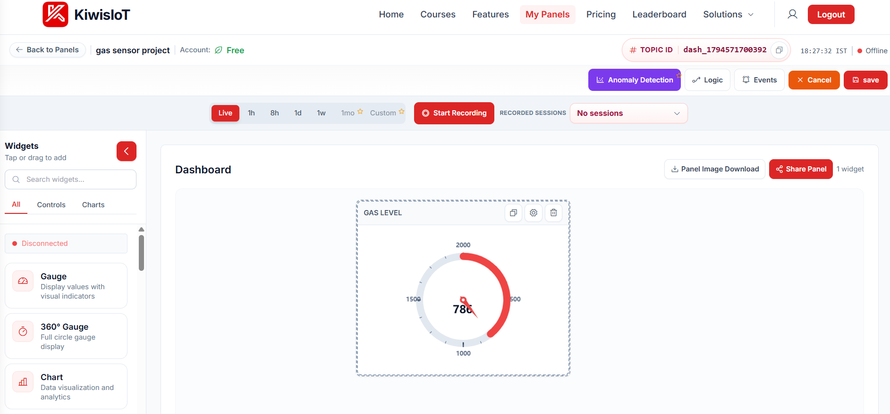
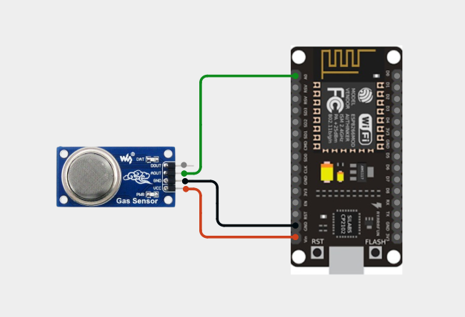
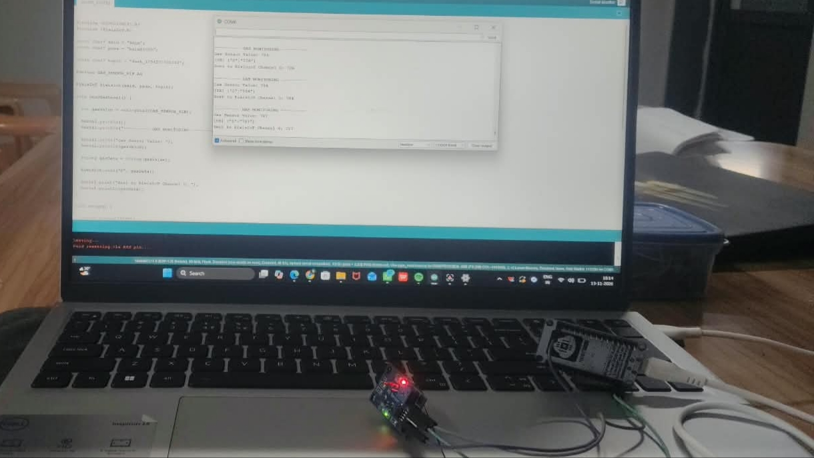

# Gas Level Monitoring System Using ESP8266 | KiwisIoT Platform

## 📌 Project Overview

This project is an IoT-based Gas Level Monitoring System developed using an **ESP8266 NodeMCU** and an **MQ-2 Gas Sensor**. It collects gas sensor readings and transmits the data over Wi-Fi to the **KiwisIoT Platform** for remote monitoring.

The sensor readings are displayed in real time through a **Gauge widget** on the KiwisIoT dashboard.



## 🚀 Key Features

- ESP8266-based IoT monitoring
- MQ-2 gas sensor integration
- Analog sensor data acquisition
- Wi-Fi-based data transmission
- KiwisIoT dashboard integration
- Real-time sensor value visualization
- Gauge widget monitoring

## 🛠️ Technologies Used

- ESP8266 NodeMCU
- MQ-2 Gas Sensor
- Arduino IDE
- C++ / Arduino
- KiwisIoT Arduino Library
- KiwisIoT Platform
- Wi-Fi

## 🔌 Hardware Components

| Component | Quantity |
|---|---|
| ESP8266 NodeMCU | 1 |
| MQ-2 Gas Sensor Module | 1 |
| Jumper Wires | As required |
| USB Cable | 1 |

## 🔧 Circuit Connection

The MQ-2 sensor module is connected to the ESP8266 NodeMCU as shown below.



### Pin Connections

| MQ-2 Sensor Pin | ESP8266 NodeMCU Pin | Wire Colour | Description |
|---|---|---|---|
| VCC | Vin | Red | Power supply to the sensor |
| GND | GND | Black | Common ground |
| AOUT | A0 | Green | Analog gas reading |
| DOUT | Not connected | – | Digital threshold output (unused) |

### Connection Diagram (Text)

```text
   MQ-2 Gas Sensor                ESP8266 NodeMCU
  ┌───────────────┐              ┌─────────────────┐
  │ VCC   ────────┼── Red ───────┼─ Vin            │
  │ GND   ────────┼── Black ─────┼─ GND            │
  │ AOUT  ────────┼── Green ─────┼─ A0             │
  │ DOUT  (unused)│              │                 │
  └───────────────┘              └─────────────────┘
```

### Wiring Notes

- The MQ-2 uses a heating element, so allow **2–3 minutes of warm-up** after power-on before taking readings.
- The NodeMCU `A0` pin is designed for an input of about **0–3.3 V**. If your MQ-2 module is powered from 5 V (`Vin`), its analog output can exceed this at high gas levels, so a simple **voltage divider** (for example, 10 kΩ and 20 kΩ) on the AOUT line is recommended for safe long-term use.
- Make sure all grounds are common (sensor GND to NodeMCU GND).



## ⚙️ Working Principle

1. The MQ-2 sensor detects changes in surrounding gas and smoke conditions.
2. ESP8266 reads the sensor's analog output through the A0 pin.
3. The sensor value is processed by the microcontroller.
4. ESP8266 transmits the data to the KiwisIoT Platform through Wi-Fi.
5. The KiwisIoT dashboard displays the received data using a Gauge widget.


## 🔄 System Architecture

```text
MQ-2 Gas Sensor
       |
       v
ESP8266 NodeMCU
       |
       v
Analog Data Acquisition
       |
       v
Wi-Fi Communication
       |
       v
KiwisIoT Platform
       |
       v
IoT Dashboard
       |
       v
Gauge Widget
```

## 📊 Dashboard Configuration

- Platform: KiwisIoT
- Channel ID: 0
- Widget: Gauge
- Parameter: Gas Sensor Value

## 💻 Software Setup

1. Install Arduino IDE.
2. Configure the ESP8266 board package.
3. Install the KiwisIoT Arduino library.
4. Configure Wi-Fi credentials.
5. Add the KiwisIoT Dashboard Topic ID.
6. Upload the Arduino program (`code/esp8266-gas-kiwisiot.ino`) to ESP8266.
7. Monitor sensor readings through the KiwisIoT dashboard.

> ⚠️ Replace `YOUR_WIFI_NAME`, `YOUR_WIFI_PASSWORD` and `YOUR_DASHBOARD_TOPIC_ID` in the code before uploading. Do not commit your real credentials to GitHub.

```cpp
/*
 * Project: Gas Level Monitoring with ESP8266 and KiwisIoT
 * Project ID: KIWISIOT-006
 * Board: ESP8266 NodeMCU
 * Sensor: MQ-2 Gas Sensor
 */

#include <ESP8266WiFi.h>
#include <KiwisIoT.h>

const char* ssid = "YOUR_WIFI_NAME";
const char* pass = "YOUR_WIFI_PASSWORD";

const char* topic = "YOUR_DASHBOARD_TOPIC_ID";

#define GAS_SENSOR_PIN A0

KiwisIoT kiwisiot(ssid, pass, topic);

void sendGasLevel() {

  int gasValue = analogRead(GAS_SENSOR_PIN);

  Serial.println();
  Serial.println("---------- GAS MONITORING ----------");

  Serial.print("Gas Sensor Value: ");
  Serial.println(gasValue);

  String gasData = String(gasValue);

  kiwisiot.send("0", gasData);

  Serial.print("Sent to KiwisIoT Channel 0: ");
  Serial.println(gasData);
}

void setup() {

  Serial.begin(115200);

  Serial.println("       GAS MONITORING       ");

  pinMode(GAS_SENSOR_PIN, INPUT);

  Serial.println("Gas sensor initialized");

  Serial.println("Connecting to KiwisIoT...");

  kiwisiot.begin();

  Serial.println("KiwisIoT initialized");
  Serial.println("Starting gas monitoring...");
}

void loop() {

  kiwisiot.run();

  static unsigned long lastSend = 0;

  if (millis() - lastSend >= 2000) {

    lastSend = millis();

    sendGasLevel();
  }

  delay(100);
}
```


## 🎯 Applications

- IoT-based gas monitoring
- Smoke monitoring concepts
- Smart home applications
- Indoor environmental monitoring
- Industrial monitoring concepts

## 🔮 Future Enhancements

- Alert notification integration
- Buzzer-based warning system
- Automated safety monitoring
- Additional sensor integration
- IoT-based automation

## ⚠️ Note

The displayed value is a raw analog sensor reading, not a calibrated gas concentration or ppm measurement. This project is an educational monitoring prototype and should not be used as a certified gas safety system.

## 👩‍💻 Project Information

**Platform:** KiwisIoT  
**Project:** Gas Level Monitoring System  
**Controller:** ESP8266 NodeMCU  
**Sensor:** MQ-2 Gas Sensor  
**Domain:** Internet of Things (IoT)
